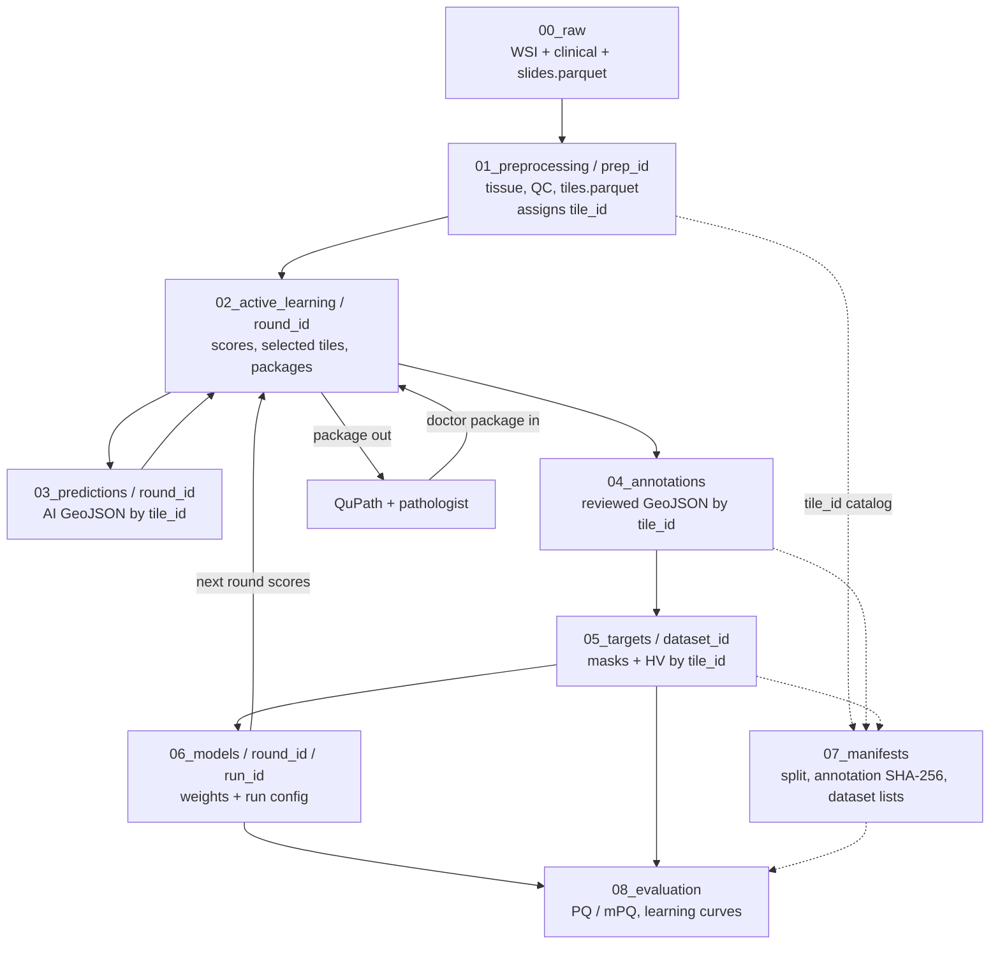

# Data layout and tile identity

`data/` is gitignored. Short tree also in the [repository README](../../README.md).

## Data flow

Solid arrows are new artefacts. Dashed arrows are references (`tile_id`, paths, checksums) without copying the WSI.



Loop: after `06_models`, the new segmentator feeds `02_active_learning` / `03_predictions` for the next round. Evaluation stays outside the selection loop (locked val/test).

## Principle

1. **Pixels stay on the WSI.** Downstream steps store coordinates and derived files, not millions of PNG crops (unless a cache is explicitly materialised).
2. **One preprocessing run is immutable.** Changing tile size, stride, QC thresholds, or GrandQC weights creates a new `prep_id`. Old runs are never overwritten.
3. **`tile_id` is the join key** for selection, QuPath packages, predictions, annotations, targets, datasets, and evaluation.
4. **Annotation FOV is fixed:** 1024×1024 px at WSI level-0. Model-native windows (e.g. 224 @ ~0.5 µm/px) are separate rows that **point at** a `tile_id`.

This matches common academic practice (manifest + coordinates as the dataset; TRIDENT/HEST-style coords keyed to slides; Histopath.ai `patch_cohort` with `tile_id`).

## Identifiers

| ID | Meaning | Example |
|---|---|---|
| `patient_id` | Pseudonym | `P00042` |
| `slide_id` | One WSI | `S00042_HE_01` |
| `prep_id` | One frozen preprocessing config + code provenance | `prep_20261027_a3f1` |
| `tile_id` | One annotation FOV from that prep | `tl_S00042_HE_01_x147456_y66048_s1024` |
| `window_id` | Optional model read window derived from a tile | `win_…_224_mpp0p5` |
| `round_id` | Active-learning round | `round_03` |
| `dataset_id` | Frozen training set | `dataset_v03` |
| `run_id` | One training job | `run_20261103_14` |

### `tile_id` rules

- Assigned **only** in `01_preprocessing/runs/<prep_id>/tiles.parquet`.
- Stable string: `{slide_id}_x{x}_y{y}_s{size}` (level-0 top-left `x`,`y`, side `size`). Optionally prefix with a short hash of `(prep_id, slide_id, x, y, w, h)` if two preps must never collide in one table.
- Every later table that mentions a field of view carries **`tile_id` + `prep_id`**. Do not join on raw `(slide_id, x, y)` alone across different preps.
- Re-running the same config on the same slides reuses the same `tile_id`s; a new config gets a new `prep_id` and a new tile table (IDs may look similar but live under another run).

### Annotation vs model size

| Role | Size | ID | Stored as |
|---|---|---|---|
| Doctor FOV / AL unit | **always 1024×1024** level-0 | `tile_id` | row in `tiles.parquet`; GeoJSON in WSI coordinates |
| FM embedding / encoder | native patch (e.g. 224 @ 0.5 µm/px) | `window_id` → `tile_id` | row in `model_windows.parquet` |
| Segmenter train crop | often 256–512 with overlap inside the FOV | `window_id` → `tile_id` | derived at train time or listed in windows table |

**How to link sizes**

1. Keep the **physical box** of the annotation tile: level-0 `(x, y, 1024, 1024)` and slide `mpp`.
2. For a model that wants side `S` px at `mpp_model`:
   - compute the level-0 side `S0 = S * (mpp_model / mpp_slide)` (same formula as TRIDENT `patch_size_level0`);
   - place one or more windows **inside** the 1024 box (grid or centre crop);
   - each window gets `window_id`, `tile_id`, `x`, `y`, `size_level0`, `size_model`, `mpp_model`, `role` (`embed` \| `segment`).
3. Labels stay on `tile_id`. Training samples are windows; the loss uses the annotation rasterised to that window (or full-tile targets cropped). Evaluation metrics for AL are reported **per `tile_id`**, not per encoder patch.

Do **not** invent a second annotation grid at 224 px. The pathologist always sees / edits the 1024 FOV (with optional context margin in QuPath).

## Directory tree

Numbers follow pipeline order.

```text
data/
  00_raw/
    wsi/<patient_id>/<slide_id>.ndpi
    clinical/
    slides.parquet
  01_preprocessing/
    runs/<prep_id>/
      config.yaml
      provenance.json
      tiles.parquet
      model_windows.parquet
      slides/<slide_id>/tissue|qc/
  02_active_learning/
    rounds/<round_id>/
    packages/
  03_predictions/
    <round_id>/by_tile/<tile_id>.geojson
  04_annotations/
    protocol_versions/
    round_00_initial_manual/by_tile/<tile_id>.geojson
    <round_id>_reviewed/by_tile/<tile_id>.geojson
  05_targets/
    <dataset_id>/by_tile/<tile_id>/
  06_models/
    fm_weights/
    <round_id>/<run_id>/
  07_manifests/
    patient_split_fixed.csv
    annotation_manifest.parquet
    datasets/<dataset_id>.parquet
  08_evaluation/
    <round_id_or_run_id>/
```

## Steps — what, where, how

### 00_raw — source slides and clinical table

De-identified inputs after PORT. Read-only once ingested. Pixels live only here; later steps store coordinates and pointers, not copies of the WSI.

| Path | What | How |
|---|---|---|
| `wsi/<patient_id>/<slide_id>.ndpi` | 40× pyramid | One file per slide; same bytes forever |
| `clinical/` | Pseudonymised clinical table | Parquet/CSV with `patient_id`, no names |
| `slides.parquet` | Slide index | `slide_id`, `patient_id`, path, `mpp`, SHA-256 |

### 01_preprocessing — tissue/QC masks and the tile catalog

One immutable run per config (`prep_id`). Creates the canonical annotation grid and assigns every **`tile_id`**. Changing stride, thresholds, or tool versions → new `prep_id`, old run kept.

| Path | What | How |
|---|---|---|
| `runs/<prep_id>/config.yaml` | Tile size 1024, stride, tissue/QC thresholds | Frozen with the run |
| `runs/<prep_id>/provenance.json` | Git commit, container digest, slide checksums | Written at run end |
| `runs/<prep_id>/tiles.parquet` | Catalog of FOVs | One row per tile: `tile_id` (PK), `prep_id`, `slide_id`, `x`,`y`, 1024×1024, QC fractions, `split` |
| `runs/<prep_id>/model_windows.parquet` | Optional encoder/train windows | `window_id` → `tile_id`; native size/MPP (e.g. 224 @ 0.5 µm/px) |
| `runs/<prep_id>/slides/<slide_id>/tissue/` | Tissue vs glass | GeoJSON / mask in level-0 coords |
| `runs/<prep_id>/slides/<slide_id>/qc/` | Artefacts (fold, pen, blur, …) | GeoJSON / mask |

### 02_active_learning — which tiles go to the doctor this round

Selector output and QuPath packages. All score/selection tables are keyed by **`tile_id`** (+ `prep_id`).

| Path | What | How |
|---|---|---|
| `rounds/<round_id>/candidate_scores.parquet` | Uncertainty, rarity, diversity per tile | One row per candidate `tile_id` |
| `rounds/<round_id>/selected_tiles.parquet` | Short list for this session | `tile_id`, reason |
| `rounds/<round_id>/embeddings.parquet` | Appearance vectors for dedup | By `tile_id` or `window_id` |
| `rounds/<round_id>/selection_config.yaml` | Selector weights / mode | Frozen per round |
| `rounds/<round_id>/annotation_time.csv` | Pathologist minutes | Appended after export; not recomputable |
| `packages/<round_id>_model/` | Outbound QuPath package | Link to WSI + AI GeoJSON + `manifest.json` |
| `packages/…__doctor__<timestamp>/` | Inbound doctor export | New folder each time; never overwrites base |

### 03_predictions — model suggestions before review

Segmentator output on selected tiles. **Not** ground truth. Kept for audit and comparison with the reviewed file.

| Path | What | How |
|---|---|---|
| `<round_id>/by_tile/<tile_id>.geojson` | Proposed cell polygons + classes | WSI level-0 coordinates; filename = `tile_id` |

### 04_annotations — pathologist ground truth

Only human-reviewed (or from-scratch) outlines. One GeoJSON per `tile_id` per round; later corrections are a **new file in a later round**.

| Path | What | How |
|---|---|---|
| `protocol_versions/` | Label schema / protocol copies | Versioned with the round |
| `round_00_initial_manual/by_tile/<tile_id>.geojson` | Round 0, drawn from scratch | No AI suggestions |
| `<round_id>_reviewed/by_tile/<tile_id>.geojson` | Accepted or corrected proposal | Copied from doctor package after checks |

### 05_targets — tensors for training

Rasterised from annotations for one frozen **`dataset_id`**. Built once per dataset version; training reads only that version.

| Path | What | How |
|---|---|---|
| `<dataset_id>/by_tile/<tile_id>/` | Instance, type, ignore masks; HV maps | Derived from the GeoJSON of that tile |
| `<dataset_id>/targets.parquet` | Index | `tile_id` → mask paths, `prep_id`, round |

Unlabelled pixels inside the FOV are **ignore**, not background.

### 06_models — weights and run configs

Checkpoints produced by training (and optional foundation-model weights if the licence allows local storage).

| Path | What | How |
|---|---|---|
| `fm_weights/` | Encoder checkpoints | Pinned release + checksum |
| `<round_id>/<run_id>/` | Segmentator weights, config, short metrics | One directory per Slurm/training job |

### 07_manifests — indexes and checksums (no pixels)

Small tables that say which files belong together. Safe to mirror selected manifests into Git.

| Path | What | How |
|---|---|---|
| `patient_split_fixed.csv` | Patient → train/val/test | Locked once; tiles inherit patient split |
| `annotation_manifest.parquet` | Every reviewed GeoJSON | `tile_id`, path, SHA-256, `round_id` |
| `datasets/<dataset_id>.parquet` | Exact tile list for one training set | Frozen list of `tile_id` + `prep_id` + paths |

### 08_evaluation — metrics and learning curves

Patient-level scores on locked val/test and AL curves (quality vs pathologist minutes). Recomputable from `06_models` + `05_targets` + manifests.

| Path | What | How |
|---|---|---|
| `<round_id_or_run_id>/` | PQ/mPQ, per-class scores, curves | Tables/plots keyed by `run_id` / `round_id` |

## Minimum columns

**`tiles.parquet`** (one row per annotation FOV)

- `tile_id`, `prep_id`, `slide_id`, `patient_id`
- `x`, `y`, `width`, `height` (level-0; width=height=1024)
- `mpp`, `stride`, `tissue_frac`, `artefact_frac`, `qc_pass`
- `split` (inherited from patient)

**`model_windows.parquet`** (optional, one row per model read)

- `window_id`, `tile_id`, `prep_id`, `role`
- `x`, `y`, `size_level0`, `size_model`, `mpp_model`

**Every AL / annotation / target / dataset table:** `tile_id`, `prep_id`.

## What stays in Git

- This document, configs that define a prep (`configs/`), label schema.
- Small manifests may be copied into Git after stripping paths with PHI risk (patient split, dataset tile_id lists). Large GeoJSON and all pixels stay on group storage.
