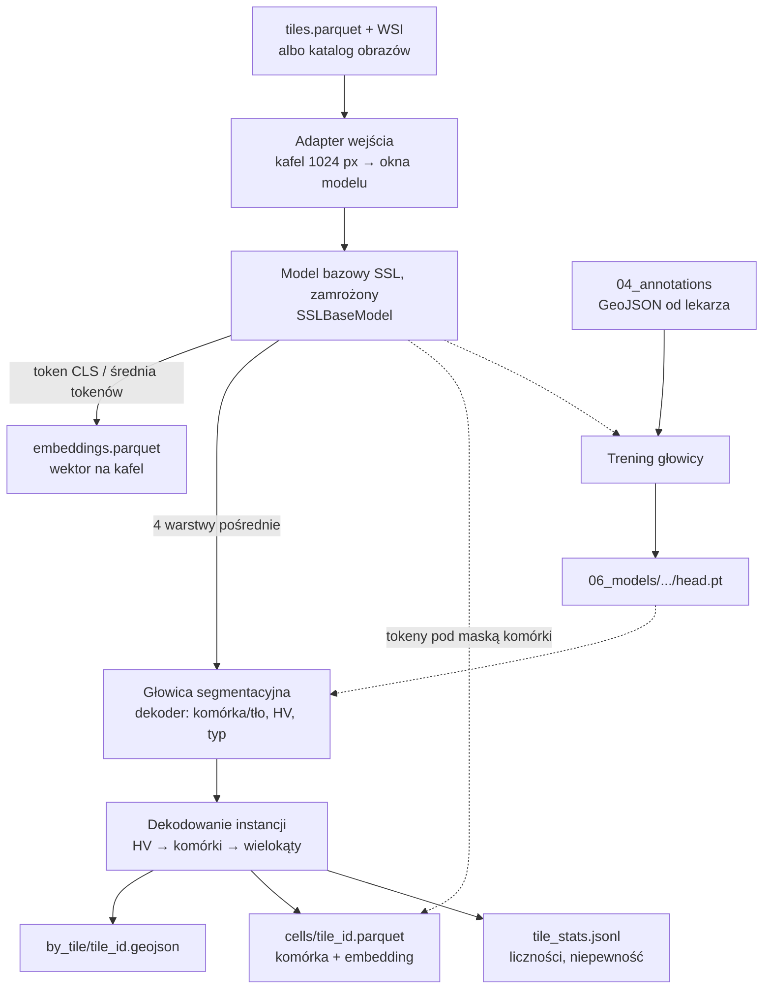

# Modele bazowe SSL: reprezentacje ukryte i segmentacja komórek

Plan rozbudowy repozytorium i stan jego wdrożenia. Dotyczy ustalenia ze spotkania 10.11.2026:
zaczynamy od modeli fundamentalnych, które dostarczają **reprezentacje ukryte** oraz
**wysegmentowane komórki**, i potrzebujemy skryptu, którym da się takie modele uruchomić do
segmentacji.

Stan na 16.11.2026. Kroki 0–11 są zaimplementowane i przetestowane lokalnie na CPU, także
na jednym prawdziwym modelu (sekcja 10). Kroki 12–19 wymagają dostępu do wag bramkowanych,
GPU albo danych i są opisane jako zadania.

## 1. Co modele bazowe dają systemowi

| Wynik | Do czego | Gdzie trafia |
|---|---|---|
| Embedding kafla (jeden wektor na kafel 1024×1024) | selektor: różnorodność, deduplikacja, klasteryzacja | `02_active_learning/rounds/<round_id>/embeddings.parquet` |
| Gęste tokeny (mapa cech kafla) | wejście głowicy segmentacyjnej, embeddingi komórek | w pamięci, w trakcie inferencji |
| Wielokąty komórek | propozycje dla lekarza w QuPath | `03_predictions/<round_id>/by_tile/<tile_id>.geojson` |
| Embedding każdej komórki | klasyfikator „megakariocyt / nie”, cechy węzłów grafu komórek | `03_predictions/<round_id>/cells/<tile_id>.parquet` |
| Statystyki kafla (liczności, niepewność) | selektor: niepewność na poziomie kafla | `03_predictions/<round_id>/tile_stats.jsonl` |

Poza zakresem tego elementu są: preprocessing i katalog kafli (`tiles.parquet`), selektor,
paczki QuPath. Z nimi łączą nas tylko kontrakty danych opisane w `schemas/`.

## 2. Decyzje projektowe

1. **Enkoder jest zamrożony, uczymy tylko głowicę.** Model bazowy nie zmienia wag; trenowany
   jest wyłącznie dekoder. Dzięki temu nie naruszamy żadnej licencji (sekcja 3), trening jest
   na tyle tani, że da się go powtarzać po każdej rundzie anotacji, a plik głowicy nigdy nie
   zawiera wag modelu bazowego i można go udostępniać.
2. **Jeden interfejs dla wszystkich modeli.** `SSLBaseModel` ukrywa różnice między `timm`
   i `transformers`, tokenami rejestrów, normalizacją. Rozmiar patcha, wymiar i układ tokenów
   są czytane z załadowanej sieci, a nie z tabelki.
3. **Adapter wejścia jest osobnym, jawnym krokiem.** Kafel lekarza ma zawsze 1024 px na
   poziomie 0, modele czytają 224 px przy ok. 0,5 µm/px. Przeliczenie robi `WindowPlanner`
   według wzoru z `data-layout.md` i zapisuje okna w formacie `model_windows.parquet`.
4. **Współrzędne zawsze level-0, klucz zawsze `tile_id`.** GeoJSON, centroidy komórek i okna
   są w układzie całego skanu.
5. **Wyniki odporne na przerwanie zadania.** Pliki per kafel pojawiają się pod docelową nazwą
   dopiero, gdy są kompletne; `--skip-existing` wznawia pracę; każdy przebieg zapisuje
   `run.json` (model, ustawienia, commit, linia poleceń).
6. **Jeden pakiet.** Katalogi z `src/` są podpakietami `mpn_al` (`pip install -e .`), a skrypty
   z `scripts/` działają też bez instalacji.

## 3. Kandydaci: modele SSL

Dane z kart modeli na Hugging Face, sprawdzone 16.11.2026. Wszystkie to Vision Transformery
uczone na kaflach 224×224 px. Nazwy z pierwszej kolumny podaje się w `--base-model`.

| Nazwa | Architektura | Wymiar | Metoda SSL | Dane treningowe | Licencja | Dostęp |
|---|---|---|---|---|---|---|
| `uni2-h` | ViT-H/14, 8 rejestrów | 1536 | DINOv2 | 200M+ kafli, 300k+ preparatów H&E i IHC | CC-BY-NC-ND-4.0 | bramkowany, e-mail instytucji |
| `uni` | ViT-L/16 | 1024 | DINOv2 | 100M kafli, 100k preparatów, 20× | CC-BY-NC-ND-4.0 | bramkowany, e-mail instytucji |
| `h-optimus-1` | ViT-g/14, 1,1 mld parametrów | 1536 | SSL (karta nie podaje metody) | ponad 1 mln preparatów | CC-BY-NC-ND-4.0 | bramkowany, e-mail instytucji |
| `h-optimus-0` | ViT-g/14, 1,1 mld parametrów | 1536 | SSL (karta nie podaje metody) | ponad 500k preparatów H&E | **Apache-2.0** | bramkowany (akceptacja warunków) |
| `h0-mini` | ViT-B/14, 86 mln parametrów | 768 | destylacja DINOv2 z H-optimus-0 | 43M kafli z TCGA | CC-BY-NC-ND-4.0 | bramkowany, e-mail instytucji |
| `virchow2` | ViT-H/14, 4 rejestry | 1280 (embedding 2560) | DINOv2 (zmodyfikowane) | 3,1 mln preparatów; 2,0 / 1,0 / 0,5 / **0,25 µm/px** | CC-BY-NC-ND-4.0 | bramkowany, e-mail instytucji |
| `virchow` | ViT-H/14 | 1280 (embedding 2560) | DINOv2 | 1,5 mln preparatów, 0,5 µm/px | Apache-2.0 | bramkowany |
| `prov-gigapath` | ViT-g/16 | 1536 | DINOv2 | Prov-Path | Apache-2.0, karta: tylko badania | bramkowany |
| `phikon-v2` | ViT-L/16 | 1024 | DINOv2 | 456M kafli, 60k preparatów, 20× | Owkin non-commercial | **otwarty** |
| `phikon` | ViT-B/16 | 768 | iBOT | 40M kafli z TCGA | Owkin non-commercial | **otwarty** |
| `midnight-12k` | ViT-g/14 | 1536 (embedding 3072) | DINOv2 (zmodyfikowane) | 12k preparatów TCGA | **MIT** | **otwarty** |
| `hibou-l` | ViT-L/14 z rejestrami | 1024 | DINOv2 | 1,2 mld kafli (prywatne) | Apache-2.0 | bramkowany |
| `lunit-dino-s16` | ViT-S/16, 21 mln parametrów | 384 | DINO | 19M kafli z TCGA | Lunit non-commercial | **otwarty** |
| `dinov2-s14` | ViT-S/14 | 384 | DINOv2 | zdjęcia naturalne (nie histologia) | Apache-2.0 | **otwarty** |

Architektura i wymiar pochodzą z kart modeli, z wyjątkami: karty H-optimus-0/1 (ViT-g/14),
Prov-GigaPath (ViT-g/16, 1536), Hibou-L (ViT-L/14) i Phikon (patch 16) tych danych nie
podają i wpisałem je z innych źródeł. Rejestr jest tylko wskazówką: `list_base_models.py
--check <model>` czyta rzeczywiste wartości z załadowanej sieci, a załadowanie modelu
ostrzega, gdy różnią się od rejestru. Do tej pory sprawdzone w ten sposób: `lunit-dino-s16`
(zgodne) i `phikon-v2` (zgodne).

Aktualną listę drukuje `python scripts/list_base_models.py`. Dowolny inny ViT da się podać
bez zmian w kodzie (`--base-model timm:<nazwa>` lub `hf:<org/repo>`), a własny enkoder uczony
u nas (np. LeJEPA albo DINO na kaflach szpiku) przez wpis w `configs/base_models/` i
`--checkpoint` z lokalnymi wagami.

### Proponowana kolejność testów

1. **`phikon-v2` i `midnight-12k`**: bez bramki, więc można je uruchomić od razu i sprawdzić
   cały przepływ na prawdziwych wagach.
2. **`h-optimus-0`**: główny kandydat na enkoder segmentatora. Ma licencję Apache-2.0, która
   pozwala dostrajać i udostępniać wagi pochodne (z dużych modeli podobnie permisywne są
   tylko `virchow`, `hibou-l` i `midnight-12k`).
3. **`uni2-h`** (na spotkaniu 27.10 wskazany do ekstrakcji cech), **`h-optimus-1`**,
   **`virchow2`**. Tylko karta Virchow2 podaje uczenie także przy 0,25 µm/px, czyli przy
   naszym powiększeniu 40×.
4. **`h0-mini`**: lekki, mieści się na laptopie; ten sam enkoder napędza HistoPLUS.
5. **`lunit-dino-s16`, `dinov2-s14`**: testy dymne i punkt odniesienia „ile daje pretrening
   na histologii”.

### Licencje a zmiana wag i LoRA

Pytanie z 26–27.10: czy licencje pozwalają zmieniać wagi. Poniżej streszczenie kart modeli,
nie porada prawna; przed publikacją trzeba przeczytać pełny tekst licencji.

- **CC-BY-NC-ND-4.0** (`uni`, `uni2-h`, `virchow2`, `h-optimus-1`, `h0-mini`): tylko
  niekomercyjne badania naukowe. Wag nie wolno rozpowszechniać, a wersji pochodnych
  (dostrojonych, po LoRA, destylowanych) nie wolno udostępniać. Dostrajanie na własny użytek
  badawczy nie jest wprost zakazane, ale jego wyniku nie opublikujemy.
- **Apache-2.0** (`h-optimus-0`, `virchow`, `hibou-l`) i **MIT** (`midnight-12k`): dostrajanie
  i udostępnianie wag pochodnych jest dozwolone.
- **Owkin / Lunit non-commercial**: tylko niekomercyjnie; karta Phikon-v2 sama odsyła do
  notatnika z LoRA.
- Modele bramkowane są licencjonowane **na osobę**: każdy, kto ich używa, musi sam
  zaakceptować warunki na swoim koncie Hugging Face (dla UNI, Virchow2, H-optimus-1 i H0-mini
  z e-mailem instytucji jako adresem głównym). Wspólny katalog z pobranymi wagami wolno
  dzielić tylko między osoby, które to zrobiły.

Przyjęta architektura (zamrożony enkoder, osobna głowica) działa z każdą z tych licencji.
LoRA albo pełne dostrajanie enkodera ma sens rozważać tylko dla modeli na licencji
permisywnej, jeśli wagi mają trafić do publikacji.

## 4. Gotowe segmentatory oparte na modelach bazowych

Punkt odniesienia dla wyboru modeli segmentacyjnych (dane z repozytoriów, 16.11.2026).

| Model | Enkoder | Co segmentuje | Wejście | Licencja | Uwagi |
|---|---|---|---|---|---|
| CellViT++ | SAM-H, HIPT-256; README: nie wszystkie checkpointy można udostępnić ze względu na licencje enkoderów | komórki/jądra, domyślnie klasy PanNuke | 0,25 µm/px (zalecane); w CellViT-Inference kafle 1024 px | Apache-2.0; kod oryginalny i pochodne HIPT z Commons Clause (bez sprzedaży i komercyjnego wykorzystania bez zgody) | eksport GeoJSON dla QuPath i grafu z embeddingami komórek (`--graph`); klasyfikator na tokenach komórek; min. 24 GB VRAM |
| HistoPLUS (Owkin) | H0-mini | jądra / komórki, 13 typów | 20× i 40×, 784 px | CC-BY-NC-ND-4.0, bramkowany | min. 8 GB VRAM; wynik w JSON |
| CellViT-Hibou-L | Hibou-L | karta wag tego nie podaje (architektura CellViT, więc najpewniej jądra) | – | CC-BY-NC-SA-4.0, bramkowany | same wagi; kod w repozytorium Hibou |
| PathoSAM | SAM | jądra | – | MIT | zespół już odnotował, że daje jądra, nie komórki |

Wnioski:

- Gotowe modele segmentują jądra lub komórki ogólnego przeznaczenia (CellViT++ domyślnie
  z klasami PanNuke, HistoPLUS: 13 typów komórek, zbiór własny Owkin). W ich opisach nie
  znalazłem wzmianki o szpiku kostnym, a maski całych megakariocytów da dopiero głowica
  uczona na naszych anotacjach.
- CellViT++, HistoPLUS (klasa `CellViTSegmentor`) i CellViT-Hibou są oparte na architekturze
  CellViT: enkoder ViT, dekoder w stylu UNETR i wyjścia w formacie HoVer-Net (mapa
  komórka/tło, mapy odległości poziomej i pionowej, mapa typów). Ten opis architektury
  pochodzi z publikacji CellViT, nie z README tych repozytoriów. Nasza głowica jest zbudowana
  w tym samym stylu, więc cele treningowe z `05_targets` (maski instancji i mapy HV) pasują
  do niej bez zmian, a wyniki da się z tymi modelami porównać.
- Te modele warto uruchomić jako baseline'y zewnętrzne do porównania (krok 16).

## 5. Co trzeba dostosować, żeby model bazowy zadziałał na naszych kaflach

| Problem | Rozwiązanie w kodzie |
|---|---|
| Kafel ma 1024 px przy ok. 0,25 µm/px, model czyta 224 px przy 0,5 µm/px | `WindowPlanner`: bok okna na poziomie 0 to `S0 = S · mpp_model / mpp_slide` (448 px), siatka 3×3 okien pokrywa kafel; embedding kafla to średnia z okien |
| Różne tryby podania kafla | `--window-mode grid` (domyślny), `center` (jedno okno), `full` (cały kafel w jednym przebiegu, 518 px dla patcha 14), `thumbnail` (cały kafel ściśnięty do 224 px) |
| Patch 14 albo 16 | segmentacja: siatka tokenów to zawsze `bok / 16`, a enkoder dostaje obraz przeskalowany do `bok / 16 · patch` (896 px dla kafla 1024 i patcha 14), więc wynik jest wyrównany co do piksela niezależnie od rozmiaru patcha |
| Inny rozmiar wejścia niż 224 px | interpolacja embeddingów pozycyjnych (`dynamic_img_size` w `timm`, `interpolate_pos_encoding` w `transformers`) |
| Normalizacja kolorów | każdy model ma własne średnie i odchylenia (H-optimus inne niż ImageNet); brane z rejestru albo z konfiguracji modelu. Uwaga na porty społecznościowe: konfiguracja portu Lunit DINO na HF podaje 0,5/0,5, a model był uczony z innymi statystykami (noty wydania Lunit), więc rejestr je nadpisuje. Przy dodawaniu modelu trzeba to sprawdzić u źródła |
| Token CLS i tokeny rejestrów | odcinane od tokenów patchy; liczba czytana z modelu |
| Rekomendowany embedding kafla | `cls` albo `cls+mean` (Virchow, Midnight), zgodnie z kartą; do zmiany przez `--pooling` |
| Rozdzielczość skanu nie jest równa 0,25 | brana z `tiles.parquet` (`mpp`), dla luźnych obrazów z `--mpp` |
| Pamięć GPU | autocast float16 (zalecany w kartach H-optimus), duże obrazy liczone w nachodzących na siebie przebiegach |
| Pobieranie wag na klastrze | pobranie na węźle logowania, zadania z `HF_HUB_OFFLINE=1`; błąd dostępu podaje, gdzie poprosić o dostęp |

## 6. Architektura



| Moduł | Zawartość |
|---|---|
| `src/image_backend/` | `TileRef`, czytanie kafli z katalogu obrazów albo z WSI według `tiles.parquet` |
| `src/embeddings/` | rejestr modeli, `SSLBaseModel`, adapter okien, `TileEncoder`, zapis Parquet |
| `src/segmenter/` | dekoder, `CellSegmenter`, dekodowanie instancji, baseline barwnikowy, embeddingi komórek, GeoJSON, potok |
| `src/training/` | cele (rasteryzacja GeoJSON, mapy HV), strata, losowe wycinki, pętla treningu |
| `src/evaluation/` | PQ / DQ / SQ, Dice |
| `scripts/` | cztery skrypty i szablony PLGrid |

## 7. Plan krok po kroku

Każdy krok: cel, gdzie jest kod, jak sprawdzić.

### Zrobione

**Krok 0. Pakiet i środowisko.** `pyproject.toml` mapuje `src/` na pakiet `mpn_al`
i deklaruje zależności; `scripts/_bootstrap.py` pozwala uruchamiać skrypty z samego checkoutu.
Sprawdzenie: `pip install -e ".[hf,dev]"`, potem `pytest`.

**Krok 1. Rejestr modeli bazowych.** `src/embeddings/registry.py`: 14 modeli z sekcji 3,
każdy z identyfikatorem, argumentami konstruktora, normalizacją, licencją i informacją
o bramce. Sprawdzenie: `python scripts/list_base_models.py`.

**Krok 2. Wspólny interfejs reprezentacji ukrytych.** `src/embeddings/base_model.py`:
`SSLBaseModel(obrazy, layers=...)` zwraca token CLS, tokeny patchy ostatniej warstwy jako mapę
`[B, D, h, w]` i takie same mapy z dowolnych warstw pośrednich. Obsługuje `timm`
i `transformers`, rejestry, dowolny rozmiar wejścia, lokalne wagi z treningu SSL.
Sprawdzenie: `python scripts/list_base_models.py --check <model>` ładuje model, drukuje fakty
o sieci i wykonuje przebieg dla 224 px i 448 px.

**Krok 3. Adapter wejścia.** `src/embeddings/windows.py`: cztery tryby okien, przycinanie
i przeskalowanie, wiersze `model_windows.parquet`.

**Krok 4. Embeddingi kafli.** `src/embeddings/tile_encoder.py` i
`scripts/extract_embeddings.py`: okna wielu kafli łączone w paczki, zapis strumieniowy do
`embeddings.parquet`, opcjonalnie embedding każdego okna i tabela okien.

**Krok 5. Głowica segmentacyjna.** `src/segmenter/decoder.py` i `model.py`: dekoder w stylu
CellViT na czterech warstwach enkodera i surowym obrazie; `CellSegmenter` spina go
z zamrożonym enkoderem; punkt kontrolny `head.pt` zawiera tylko dekoder i przepis na resztę.

**Krok 6. Dekodowanie instancji i eksport.** `src/segmenter/postprocess.py`: mapy HV →
markery → rozlewanie poziomicowe (bez scikit-image) → instancje → wielokąty z klasą
i pewnością. `geojson.py` zapisuje je w dialekcie QuPath, domyślnie jako edytowalne anotacje.

**Krok 7. Embeddingi komórek.** `src/segmenter/cell_features.py`: tokeny modelu bazowego
uśrednione pod maską komórki, z wagą proporcjonalną do pokrycia.

**Krok 8. Baseline bez etykiet.** `src/segmenter/stain_baseline.py`: kandydaci na jądra
z kanału hematoksyliny. To klasyczna metoda, **nie segmentacja modelem bazowym**; służy do
uruchomienia całego łańcucha, zanim powstanie pierwsza głowica, i jako poziom odniesienia.
Model bazowy liczy w tym trybie tylko embeddingi znalezionych jąder.

**Krok 9. Trening głowicy.** `src/training/`: rasteryzacja anotacji QuPath (klasy, aliasy,
`ignore`, ROI), mapy HV liczone w locie, strata z maską `ignore`, wycinki z symetriami
i zmianą kolorów, walidacja PQ na całych kaflach, start z głowicy poprzedniej rundy
(`--init-head`).

**Krok 10. Skrypty.**

| Skrypt | Zadanie |
|---|---|
| `scripts/list_base_models.py` | lista kandydatów; `--check` weryfikuje jeden model |
| `scripts/extract_embeddings.py` | embeddingi kafli |
| `scripts/segment_cells.py` | **segmentacja komórek modelem bazowym**: `--head` (enkoder + głowica) albo `--baseline stain` |
| `scripts/train_segmentation_head.py` | trening głowicy na anotacjach |
| `scripts/plgrid/` | środowisko i szablon zadania Slurm (także tablice zadań) |

**Krok 11. Testy.** `tests/`: 102 testy, około 2,5 minuty na CPU, bez sieci (małe, losowo
inicjalizowane ViT). Obejmują m.in. zgodność wrappera ze zwykłym przebiegiem `timm`, wariant
z patchem 14 i z rejestrami, backend `transformers`, geometrię okien, odtworzenie instancji
z idealnych map HV, rundę GeoJSON → rasteryzacja, naukę głowicy na syntetycznych komórkach,
wznowienie przerwanego przebiegu i uruchomienie skryptów z samego checkoutu. Dochodzą narzędzia
klastrowe: shardy zadań tablicy ze scalaniem, pobieranie wag z atrapą Hugging Face, test dymny
na CPU oraz skrypty PLGrid pod bashem względem atrapy klastra (atrapy `ssh`, `scp`, `sbatch`).

### Do zrobienia

**Krok 12. Dostępy i wagi.** Każda osoba, która będzie uruchamiać modele bramkowane, składa
wniosek na swoim koncie Hugging Face (dla `uni2-h`, `h-optimus-1`, `virchow2`, `h0-mini`
z adresem PWr jako głównym) i loguje się własnym tokenem na klastrze. Narzędzie jest gotowe:
`bash scripts/plgrid/remote.sh download <model> --verify` pobiera wagi na węźle logowania do
`HF_HOME` i ładuje je offline ([plgrid.md](plgrid.md), sekcja 3). Kryterium: `--verify` kończy
się `verified` dla każdego modelu.

**Krok 13. Weryfikacja na GPU.** Narzędzie jest gotowe, ale **niewykonane na Atenie**:
`bash scripts/plgrid/remote.sh smoke --models lunit-dino-s16 phikon-v2`. Zleca job A100,
który na danych syntetycznych sprawdza dla każdego modelu ładowanie offline, przebiegi enkodera
w float32 i float16, embeddingi, trening głowicy z autocastem, segmentację i spójność wyników,
a potem testy jednostkowe. Kryterium: `SMOKE TEST PASSED`. Raport (wersje, karta, czasy, pamięć)
trzeba wpisać do sekcji 10 tego dokumentu; do tego czasu ścieżka CUDA z float16 i zgodność torch
ze sterownikiem węzłów nie są potwierdzone (lokalnie jest tylko PyTorch w wersji CPU).

**Krok 14. Embeddingi dla puli kafli.** Po dostarczeniu `tiles.parquet` z preprocessingu:
`extract_embeddings.py` dla dwóch lub trzech modeli, każdy do osobnego pliku. Kryterium:
selektor czyta plik i klasteryzacja daje sensowne grupy (obejrzeć kilka kafli z klastra).

**Krok 15. Pierwsza głowica: megakariocyt albo tło.** Na publicznym zbiorze od dr. Zduniaka
(klasy `meg_*`), ze schematem `configs/labels/megakaryocyte_binary.yaml`. Wcześniej trzeba
ustalić z lekarzem mapowanie klas i znaczenie ROI (sekcja 9). Kryterium: PQ na pacjentach
walidacyjnych wyraźnie powyżej baseline'u, propozycje otwierają się w QuPath na właściwym
miejscu skanu.

**Krok 16. Porównanie enkoderów.** Ta sama głowica, te same kafle i podział, różne modele
bazowe i dwie rozdzielczości pracy (`--seg-mpp` 0,25 i 0,5); do tego zewnętrzne baseline'y
z sekcji 4. Wynik: tabela PQ / DQ / SQ oraz czas na kafel, z której wybieramy enkoder.

**Krok 17. Klasyfikator komórek na embeddingach.** Najpierw „megakariocyt / nie”, potem
podtypy megakariocytów: lekka głowica (regresja logistyczna albo mały MLP) na embeddingach
z `cells/*.parquet`, z etykietami przypisanymi przez dopasowanie komórek do anotacji.
Alternatywa już dostępna: schemat etykiet z kilkoma klasami włącza w głowicy gałąź typów.

**Krok 18. Włączenie w pętlę aktywnego uczenia.** Predykcje rundy trafiają do paczki QuPath;
`tile_stats.jsonl` zasila `candidate_scores.parquet` selektora; po powrocie poprawek głowica
jest douczana z `--init-head`; identyfikatory rund i przebiegów pochodzą z menedżera zadań.

**Krok 19. Rozszerzenia.** Ramka kontekstu wokół kafla (predykcja na większym wycinku,
zostają komórki ze środkiem w kaflu), LoRA dla enkoderów na licencji permisywnej, własny
enkoder SSL uczony na nieoznaczonych kaflach szpiku, cache cech enkodera na czas treningu,
więcej niż jeden kafel w paczce przy inferencji.

## 8. Uruchamianie

Lokalnie (Windows; w Linuksie aktywacja to `source .venv/bin/activate`):

```bash
python -m venv .venv
.venv\Scripts\activate
pip install -e ".[hf,dev]"
pytest
python scripts/list_base_models.py
```

`pip install torch` w Windows instaluje wersję CPU; wersję CUDA instaluje się z indeksu
PyTorch. Do pracy na WSI potrzebny jest dodatek `wsi` (`pip install -e ".[wsi]"`).

Pierwsze uruchomienie na prawdziwym modelu, bez bramki (pobiera wagi z Hugging Face):

```bash
python scripts/list_base_models.py --check phikon-v2
python scripts/extract_embeddings.py --base-model phikon-v2 --images kafle_png --mpp 0.25 --out outputs/embeddings.parquet
python scripts/segment_cells.py --baseline stain --base-model phikon-v2 --images kafle_png --mpp 0.25 --out outputs/baseline
```

Trening głowicy i segmentacja modelem bazowym:

```bash
python scripts/train_segmentation_head.py --base-model h-optimus-0 --images kafle_png --annotations anotacje_geojson --labels configs/labels/megakaryocyte_binary.yaml --mpp 0.25 --val-fraction 0.2 --out data/06_models/round_00/run_001
python scripts/segment_cells.py --head data/06_models/round_00/run_001/head.pt --tiles-parquet data/01_preprocessing/runs/PREP_ID/tiles.parquet --slides-parquet data/00_raw/slides.parquet --out data/03_predictions/round_01
```

PLGrid (Athena), z Git Basha, z katalogu repozytorium. Skrypty są przetestowane na atrapie
klastra, ale nie uruchomione na Atenie. Pełny opis, kryterium zaliczenia i rozwiązywanie
problemów: [plgrid.md](plgrid.md).

```bash
bash scripts/plgrid/remote.sh sync
bash scripts/plgrid/remote.sh setup
bash scripts/plgrid/remote.sh download phikon-v2 lunit-dino-s16 --verify
bash scripts/plgrid/remote.sh smoke --models lunit-dino-s16 phikon-v2
bash scripts/plgrid/remote.sh submit --array=0-7 scripts/segment_cells.py --head '$SCRATCH/mpn_al_runs/round_00/run_001/head.pt' --images '$SCRATCH/mpn_al_data/tiles' --mpp 0.25 --out '$SCRATCH/mpn_al_runs/round_01/predictions' --skip-existing
```

Formaty wyników: [embeddings.parquet](../../schemas/embeddings.parquet.md),
[wyniki segmentacji](../../schemas/cells.parquet.md),
[głowica i dane treningowe](../../schemas/segmentation_head.md).

## 9. Otwarte decyzje

1. **Nieoznaczone piksele: tło czy `ignore`?** `data-layout.md` mówi, że nieoznaczone piksele
   w kaflu to `ignore`. Jeśli tak ma zostać, głowica nie zobaczy ani jednego przykładu tła
   i niczego się nie nauczy. Potrzebne jest jedno z dwóch: lekarz obrysowuje wszystkie komórki
   w kaflu (wtedy reszta to tło), albo zaznacza obszar ROI opisany w całości (wtedy tło jest
   wewnątrz ROI, a reszta to `ignore`). Kod obsługuje oba warianty (`--unlabeled`, klasa ROI).
2. **Jądra czy całe komórki.** Baseline barwnikowy i gotowe modele dają jądra. Głowica uczy
   się tego, co obrysuje lekarz; trzeba więc ustalić w protokole, że obrys megakariocytu
   obejmuje cytoplazmę.
3. **Mapowanie klas QuPath.** `bare_nucleus`, `dwarf`, `cytoplasm`: megakariocyt, osobna klasa
   czy część komórki? W szkicu `megakaryocyte_binary.yaml` są na razie wyłączone ze straty.
4. **Rozdzielczość pracy głowicy.** 0,25 µm/px jest potrzebne dla małych komórek; dla samych
   megakariocytów wystarczy 0,5 µm/px i jest około cztery razy taniej.
5. **Komórki na krawędzi kafla.** Są zapisywane z flagą `touches_border`; o ich losie decyduje
   protokół anotacji. Ramka kontekstu jest w kroku 19.
6. **Podział walidacyjny.** `--val-fraction` dzieli losowo po kaflach i nadaje się tylko do
   prób. Do wyników, które raportujemy, trzeba podać `--val-ids` z ustalonego podziału po
   pacjentach.

## 10. Próba na prawdziwych modelach (16.11.2026)

Dwa otwarte modele: `lunit-dino-s16` (ViT-S/16, 87 MB, backend `timm`) i `phikon-v2`
(ViT-L/16, 1,2 GB, backend `transformers`), na laptopie bez GPU i na trzech obrazach H&E
szpiku z publicznego zbioru BaMBo (przyjęte 0,5 µm/px; BaMBo nie podaje rozdzielczości).
Wszystkie cztery skrypty przeszły na prawdziwych wagach `lunit-dino-s16`:

- `list_base_models.py --check`: model ładuje się z Hugging Face i z cache w trybie offline,
  działa dla wejścia 224 px i 448 px.
- `extract_embeddings.py`: okna tego samego obrazu są do siebie podobne (średni cosinus
  0,75), okna różnych obrazów wyraźnie mniej (0,40).
- PCA gęstych tokenów rozdziela na obrazie tkankę krwiotwórczą, przegrody tkanki tłuszczowej
  i tło, czyli reprezentacje niosą informację o budowie tkanki.
- `train_segmentation_head.py`: głowica (9,4 mln parametrów, enkoder zamrożony) uczona 240
  kroków na CPU (9,5 minuty) na jednym obrazie, strata spadła z 5,7 do 1,3.
- `segment_cells.py --head`: 14 sekund na obraz na CPU; obrysy na obrazie spoza treningu
  trafiają w jądra.

BaMBo nie ma obrysów komórek, więc głowicę uczono na **etykietach zastępczych z baseline'u
barwnikowego**. Poniższe liczby mierzą zgodność z tym baseline'em, a nie poprawność
segmentacji, i pochodzą z jednego przebiegu:

| Obraz | Rola | Obiekty baseline'u | Obiekty głowicy | PQ | DQ | SQ | Dice |
|---|---|---|---|---|---|---|---|
| PGI_24, skan 151 | treningowy | 1012 | 983 | 0,68 | 0,81 | 0,84 | 0,92 |
| PGI_1, skan 67 | walidacyjny, to samo źródło | 694 | 852 | 0,40 | 0,65 | 0,61 | 0,69 |
| PGI_39_TEST, skan 39 | walidacyjny, inny wygląd obrazu | 457 | 344 | 0,16 | 0,26 | 0,63 | 0,47 |

Wnioski z próby:

- Cały łańcuch (prawdziwy enkoder → głowica → GeoJSON i embeddingi komórek) działa i głowica
  się uczy. Na obrazie 39 komórki są na oko wyraźnie drobniejsze niż na pozostałych (ok. 4–6
  px wobec ok. 13 px), więc przyjęte 0,5 µm/px najpewniej dla niego się nie zgadza (BaMBo nie
  zapisuje rozdzielczości, a ten obraz ma inny rozmiar, 512×512). Niski wynik na nim mówi
  więc głównie o niedopasowanej skali, nie o enkoderze; z jednego obrazu treningowego nie da
  się też oczekiwać przenoszenia na inne barwienie. Rozdzielczość musi być jawnie podana
  (`--mpp` albo `mpp` w `tiles.parquet`).
- Konfiguracja pobranego modelu podawała normalizację 0,5/0,5, a noty wydania Lunit podają
  inne statystyki (sekcja 5); rejestr używa tych drugich, bo to one są źródłem. Sonda liniowa
  na tokenach dała różnicę w tę samą stronę (R² 0,82 wobec 0,80 dla konfiguracji z Hugging
  Face i dla statystyk ImageNet), ale na dwóch obrazach jest ona za mała i za zaszumiona, żeby
  traktować ją jako dowód.
- Embeddingi komórek grupują się przede wszystkim według obrazu, z którego pochodzą (k-means
  na 2163 komórkach: 95% komórek w grupie zdominowanej przez własny obraz dla Lunit i 100%
  dla Phikon-v2). Przy trzech obrazach to tylko sygnał, ale klasyfikator komórek z kroku 17
  trzeba będzie walidować po pacjentach i liczyć się z normalizacją barwienia albo
  centrowaniem embeddingów w obrębie preparatu.

### Phikon-v2: backend `transformers` na prawdziwych wagach

Te same trzy obrazy, CPU, offline z cache.

- Zgodność z przepisem z karty modelu (`AutoModel`, `last_hidden_state[:, 0]`): embedding
  kafla 224 px różni się o 2·10⁻⁶ (cosinus 1,000000). Przy wejściu 336×448 px tokeny patchy,
  token CLS i stany ukryte warstw 5 i 23 są identyczne co do bitu z bezpośrednim wywołaniem
  modelu Hugging Face, więc adapter (odcięcie tokenu CLS, układ siatki, indeksy warstw) jest
  poprawny.
- Tokenów-artefaktów o dużej normie nie ma (maksimum 1,3× mediany).
- Pokrycie jądrami (etykiety zastępcze z baseline'u) da się liniowo odczytać z tokenów
  w obrębie jednego obrazu (R² 0,84; Lunit 0,88). Między dwoma obrazami wyniki są
  niestabilne dla obu modeli (średnio 0,17 dla Phikon-v2 i 0,44 dla Lunit, a w obrębie pary
  0,03 i 0,32 oraz 0,75 i 0,12), bo etykiety mają próg Otsu liczony osobno dla każdego
  obrazu. Ta miara nie pozwala uszeregować enkoderów.
- Czasy na CPU: embeddingi 3 kafli (111 okien) ok. 46 s, baseline z embeddingami komórek
  63 s, trening głowicy (80 kroków, 12,7 mln parametrów, strata 6,0 → 2,7) 7,6 min łącznie
  z jedną walidacją, segmentacja ok. 36 s na obraz przy `--max-size 512`.
- Głowica ładuje się z samego pliku `head.pt` i odtwarza enkoder z hub'a. Maska, tabela
  komórek i GeoJSON mają tę samą liczbę obiektów, a embedding komórki ma 1024 wymiary.
- Zgodność z etykietami zastępczymi po 80 krokach: PQ 0,44 (obraz treningowy), 0,33 i 0,06
  (walidacyjne). Trening był trzy razy krótszy niż dla Lunit, więc tych liczb nie wolno
  porównywać z tabelą wyżej i nie rozstrzygają one, który enkoder jest lepszy. To wymaga
  prawdziwych anotacji (krok 16).

## 11. Czego jeszcze nie sprawdzono

- Duże modele bramkowane (UNI2-h, H-optimus, Virchow2): nie były pobierane. Ich ścieżki kodu
  (patch 14, rejestry, SwiGLU) testowano tylko na losowo inicjalizowanych ViT o tych samych
  cechach konstrukcyjnych, a argumenty konstruktorów pochodzą z kart modeli. Backend
  `transformers` sprawdzono na Phikon-v2; `midnight-12k` (normalizacja 0,5) i `hibou-l`
  (`trust_remote_code`) nie były ładowane.
- Ścieżka GPU z autocastem float16 nie była uruchamiana. Pierwszy przebieg to `remote.sh smoke`
  (krok 13).
- Czytanie kafli z WSI przetestowano na atrapie interfejsu OpenSlide, nie na pliku NDPI.
- Skrypty PLGrid (`remote.sh`, zadania Slurm, `setup`, `smoke`) są przetestowane na atrapie
  klastra i na CPU, a nie na Atenie. Atrapa pokazuje, że logika skryptów jest poprawna, ale nie
  to, że klaster zachowuje się tak, jak zakładają atrapy: instalacja pakietów, moduły, kolejka,
  wersja torch względem sterownika i uprawnienia konta/partycji wyjdą dopiero na klastrze.
- Jakość segmentacji względem anotacji lekarza: nie ma jeszcze żadnej liczby, w szczególności
  dla megakariocytów.
